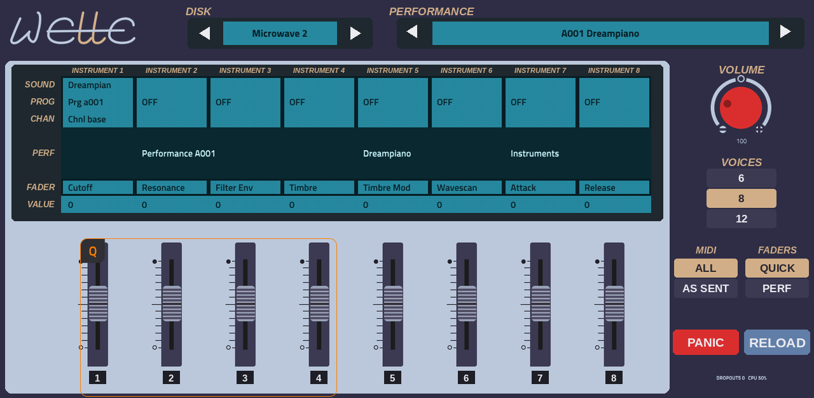
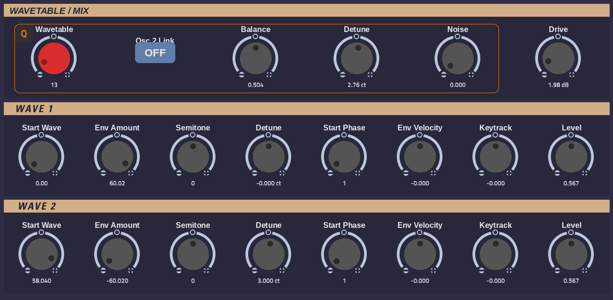
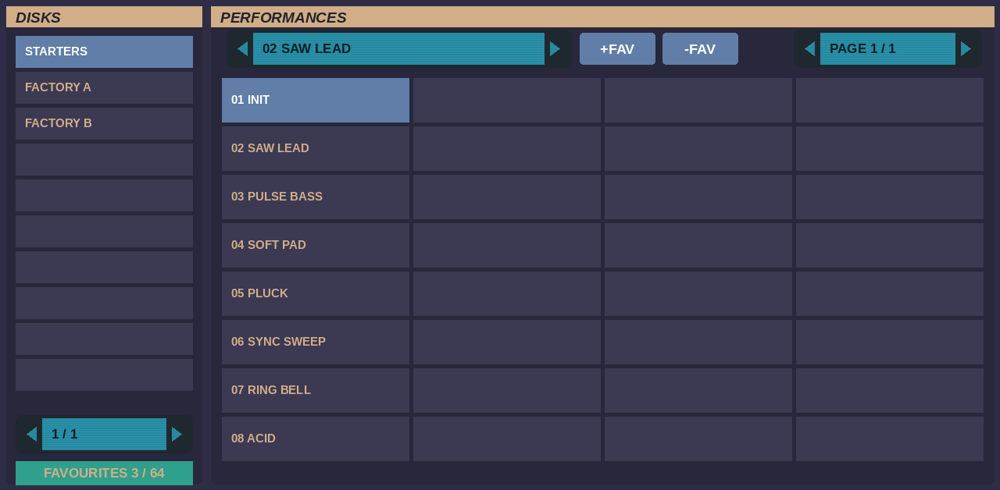
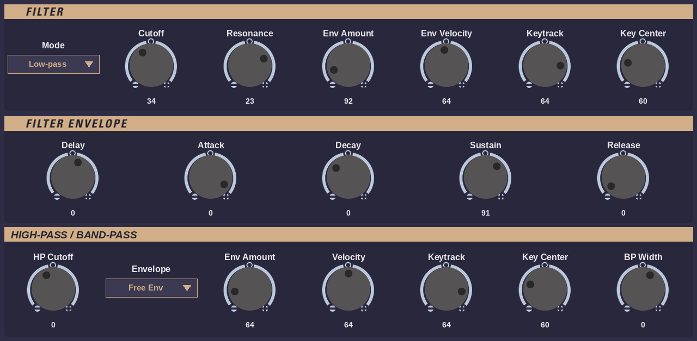

# Welle for MPC

A Waldorf Wave emulation that runs as a plugin instrument on **Akai MPC Gen2 standalone devices** (MPC Live III and other aarch64 MPCs),
with a full touchscreen editor, the Wave's LCD and performance faders, and Q-Link control.

It is built on [Wave Emulation](https://github.com/mo0kid/wave) by mo0kid: a model of the Wave's voice circuits (the 250 kHz 8-bit
wavetable voices, the ES2 ASIC, the CEM3387 filters) driven by the instrument's own OS 1.700, running on emulated 68000s.



## Features
- **The Wave's own OS:** OS 1.700 boots on the emulated master and voice-board CPUs and runs the instrument: performances,
  instruments, the factory wavetables (generated by the OS itself) and its sound handling.
- **Wave sound sets as disks:** every Wave setup file (`.set`, such as the factory set) or Wave disk image (`.img`) in `banks/` is a
  disk of 256 performances, with their names.
- **The LCD on the MAIN page:** the Wave's 480 x 64 graphic display is read back as text with the fonts of your own OS file and shown on
  its eight columns and text rows, with its inverted bars and boxes, live.
- **Eight faders under the LCD, as on the instrument.** In **Quick** mode (the default) they are whole-performance offsets: Cutoff,
  Resonance, Filter Env, Timbre, Timbre Mod, Wavescan, Attack and Release, shown by name and value on the LCD and centred again on every
  performance change (a survey of the factory and artist sets found 99% of the stored performance faders left at their default, so the
  stored assignments rarely do anything). In **Perf** mode they are the Wave's performance faders, as each performance assigns them.
- **Favourites in the MPC PRESET menu:** press **+FAV** on DISKS, name the sound on the keyboard that opens (up to 20 characters; SHIFT, DEL, SPACE, CANCEL, SAVE) and SAVE keeps it with all its edits; then pick it from MPC's own
  preset list. **-FAV** removes it. Up to 64 favourites, kept across projects.
- **RANDOM** on DISKS loads a random disk and a random performance from it. The disk list shows the loaded disk in a readout with < > steppers (as the performance one does), and the selected disk and performance stay lit.
- **A complete editor on the touchscreen:** MAIN, DISKS, WAVES, WAVE ENV, FILTER, AMP, LFO / GLIDE, MOD 1-4, FREE ENV, QUICK. Every one of
  Wave Emulation's sound parameters, and twelve Quick Edit offsets, on Q-Links in blocks of four that match the printed sections of each page.
  Knobs look like the instrument's (red for Wavetable, Cutoff and Volume); choices such as filter mode, LFO shape or a modulation source open a
  pick-list.
- **DISKS page:** the loaded disk in a readout with < > steppers and 11 disk tiles on the left, a page of 32 performances on the right, the current performance with RANDOM, +FAV and -FAV.


- **MIDI "All parts":** performances that put their instruments on separate MIDI channels play whole from one MPC track (or choose
  "As sent" to drive the parts from separate tracks).
- **Saved with your project:** the disk, performance and every edit come back when the project is reopened.



## Performance
The Wave's voices are modelled circuit by circuit and are heavy. Welle spreads them over three of the MPC Live III's fast cores (one per
voice board, as the instrument has). Measured on an MPC Live III with notes held:

| Voices | Sounds | |
|---|---|---|
| 6 | all | plenty of headroom |
| **8** (default) | all, including the layered factory performances | no dropouts |
| 12 | lighter sounds | the layered factory performances drop out |

Choose on MAIN (VOICES). A performance or disk change takes a moment of silence while the OS loads the performance.

## Requirements
- An MPC Gen2 standalone device (aarch64, e.g. MPC Live III) on MPC OS 3.x (3.10.1 or later for the SDK-format zip). Gen1 devices and the Force aren't supported.
- **Wave OS 1.700:** `w2sys.bin` and `wdv.sys`. Waldorf publishes the Wave's system files on its
  [legacy Wave page](https://waldorfmusic.com/legacy-wave/). No firmware is included.
- **Sounds:** Wave setup files or disk images, such as Waldorf's factory set (`wave.set`) and the artist sets from the same page.
  None are included. Without any, the Wave starts with its initialised memory ("MULTI INIT").

## Install
There are two plugin formats. Use one of them, not both: they are the same plugin.

| Plugin format | How it is installed | Plugin folder |
|---|---|---|
| **SDK format** (MPC OS 3.10.1 or later) | By hand: download `Welle-<version>-VST2-Plugins.zip` from [Releases](https://github.com/sd88me/mpc-vst-welle/releases), unzip it and copy the `VST2 Plugins` folder to the root of a drive the MPC can see (internal storage, SD card or USB drive). If that drive already has a `VST2 Plugins` folder, copy the `sd88me - VST - Welle` folder into it. Turn on **Preferences > Enhancements (Beta) > Enable Enhancements** and **External Plugin Support**, and restart the MPC. | `VST2 Plugins/sd88me - VST - Welle/` on that drive |
| **Older format** (plugins listed in `MPC.settings`) | With the **OpenMPC Plugin Manager**: install Welle from it. | `sd88me - VST - Welle/` in the Synths folder it installed to |

### Adding Wave OS and sound sets
Both go in the plugin folder's `Content/` (the zip already has the folders):
- `w2sys.bin` and `wdv.sys` in `Content/roms/`, for example `VST2 Plugins/sd88me - VST - Welle/Content/roms/`.
- Your Wave sound sets (`.set` or `.img`) in `Content/banks/`. Name them as you want them listed; a set whose name starts with
  "Factory" comes first. A setup file is turned into a disk image in `Content/cache/` the first time it is loaded.

| Plugin format | How to add them |
|---|---|
| SDK format | By hand: over USB, or with the MPC's file browser. |
| Older format, with the OpenMPC Plugin Manager | Use its **Your ROMs and files** step: it checks each file and copies it into the right folder, saving the two Wave OS files as `w2sys.bin` and `wdv.sys`. Or copy them by hand. |

Then load **Welle** on a plugin track from the External VST Plugins list.

### Upgrading
- **SDK format:** copy the new `sd88me - VST - Welle` folder over the old one (merge it, don't delete the old folder first) so
  `Content/` (your Wave OS files, sound sets and favourites) stays.
- **Older format:** the OpenMPC Plugin Manager updates Welle in place; your Wave OS files and sound sets stay in `Content/`.

#### From 0.1
Replace the `sd88me - VST - Welle` folder with the new one, but first copy your `VST/welle` folder (your `roms/`, `banks/` and
`favourites.txt`) somewhere safe. Welle 0.2 still uses `VST/welle/` if it exists, so you can leave it in place, or move `roms/`, `banks/` and
`favourites.txt` to `Content/`. Your projects load as before.

## Backing up your favourites and sounds

Your favourites and your own files are kept in the plugin folder on the MPC, not in your projects (a project keeps only the sound its
track uses). Back them up before you update the plugin or MPC OS, reset the device, or move to another MPC. These are the files to keep,
inside the plugin folder `sd88me - VST - Welle`:

| File or folder | What it holds |
|---|---|
| `Content/favourites.txt` | your favourites |
| `Content/banks/` | your sound sets |
| `Content/roms/` | your Wave OS files |

Your ROMs are yours to keep with your backup, but don't share them.

### Where the plugin folder is
It is in `VST2 Plugins` on one of the MPC's drives, or in a Synths folder (`/sdcard/Synths`, or `/nvme/Synths` on a Live III),
depending on how Welle was installed. Over SSH (root access), this prints its path:

```bash
ssh root@<device-ip> 'find /sdcard /nvme /media -maxdepth 3 -type d -name "sd88me - VST - Welle" 2>/dev/null'
```

### Backing up
- **The plugin folder is on an SD card or USB drive:** plug the drive into a computer and copy the files above to it.
- **Over SSH**, from a computer: this copies the whole plugin folder into one file, `welle-backup.tar`. Put the folder that holds the
  plugin folder (the path above without its last part) in place of `<parent folder>`:

  ```bash
  ssh root@<device-ip> 'cd "<parent folder>" && tar cf - "sd88me - VST - Welle"' > welle-backup.tar
  ```

### Restoring
Install Welle first (on the new device, or after the reset or update), then put back only the files above. Don't copy the whole
old folder over the new one: that would put the old version of the plugin back too.

- **From a drive:** copy the files back to the same places in the new plugin folder.
- **Over SSH:** unpack the backup on your computer and send the files back. List only the ones your backup has, and put the new
  plugin folder's path (found as above) in place of `<plugin folder>`:

  ```bash
  mkdir welle-backup && tar xf welle-backup.tar -C welle-backup
  tar cf - -C "welle-backup/sd88me - VST - Welle" "Content/favourites.txt" "Content/banks" "Content/roms" | ssh root@<device-ip> 'cd "<plugin folder>" && tar xf -'
  ```

Then remove Welle from its tracks and add it again (or reopen the project), so it reads the restored files.

## What's new in 0.2
Welle now uses Akai's MPC Plugin SDK: a native skin on every page (live LCD text, fader and knob strips, Q-Link blocks), a DISKS page with all
your disks and performances, pick-lists for choices, single-press buttons, and the disk, performance and favourite names kept in step with the
sound. The sound engine and the parameter order are unchanged.

## Tips
- The Wave OS boots in about 3 seconds. **PANIC** stops stuck notes; **RELOAD** reloads the stored performance (drops your edits).
- In Perf mode the faders' cells on the LCD show `???` until a fader is moved: the Wave's faders aren't motorised, so the OS doesn't know their
  position until then.
- Some performances pan or move their sound between the sides on purpose (a random pan, a layer per side).



## Building from source
You need Docker, Python 3 with Pillow, a C compiler for the build machine, and a checkout of Akai's MPC Plugin SDK (point `MPC_SDK` at it).
```
./build-sdk.sh test        # x86 engine + the SDK's host simulator (parameters, programs, state, audio path)
./build-sdk.sh             # fetches JUCE 8.0.15 and Musashi, builds the aarch64 plugin folder in build/sdk/ (skin from tools/make_tui.py)
./build-sdk.sh beta        # the same as "Welle 2 Beta", which installs next to the release
tools/package.sh           # dist/Welle-<version>-VST2-Plugins.zip
```
`build/<arch>/welle_engine_test <dir with roms/>` boots the OS and checks notes, parameters, the LCD, favourites and the saved state;
with `WV_TEST_BANKS=1` it plays every bank in `<dir>/banks/`. Run the aarch64 one on the device.

How Wave Emulation is built headless for the MPC, and what is changed in it, is in [src/VENDORED.md](src/VENDORED.md).

## Credits
Welle for MPC is built on other people's work. See [CREDITS.md](CREDITS.md) for the details.
- **[Wave Emulation](https://github.com/mo0kid/wave)** by mo0kid: the emulation, and the panel artwork the skin's knobs, fader slots and
  section titles come from.
- **[JUCE](https://juce.com)** and **[Musashi](https://github.com/kstenerud/Musashi)**, which Wave Emulation is built on.
- **Akai's MPC Plugin SDK** (MIT): the plugin framework and the skin format.

## Licence
**GPL-3.0**: see [LICENSE](LICENSE). The bundled components keep their own licences (GPL-3.0, AGPL-3.0, MIT, SIL OFL 1.1), as listed in
CREDITS.md.

*Welle for MPC is an independent project, not affiliated with or endorsed by Waldorf. "Wave" is the name of the instrument it emulates.
Waldorf and Wave are trademarks of their owners.*
