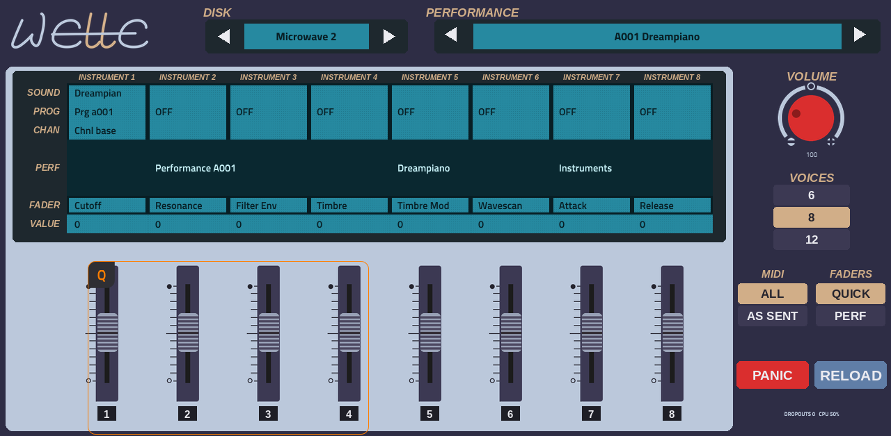
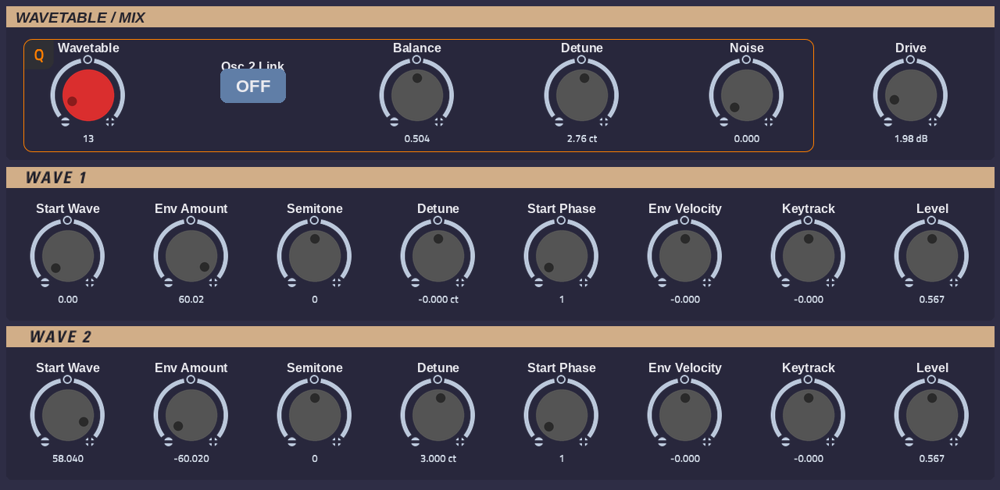
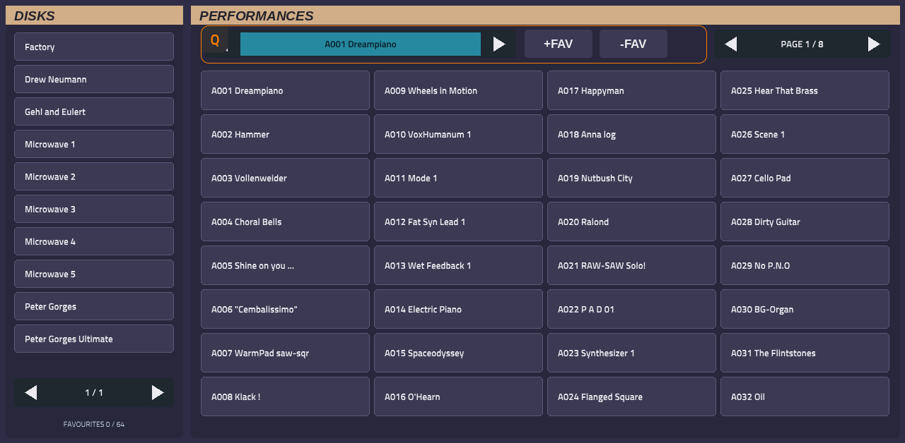
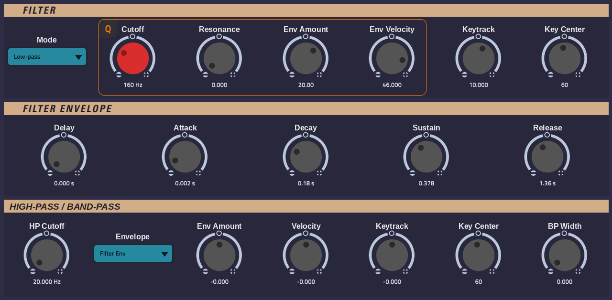

# Welle for MPC

A Waldorf Wave emulation that runs as a plugin instrument on **Akai MPC Gen2 standalone devices** (MPC Live III and other aarch64 MPCs),
with a full touchscreen editor, the Wave's LCD and performance faders, and Q-Link control.

It is built on [Wave Emulation](https://github.com/mo0kid/wave) by mo0kid: a model of the Wave's voice circuits (the 250 kHz 8-bit
wavetable voices, the ES2 ASIC, the CEM3387 filters) driven by the instrument's own OS 1.700, running on emulated 68000s.



## Features
- **The Wave's own OS:** OS 1.700 boots on the emulated master and voice-board CPUs and runs the instrument: performances,
  instruments, the factory wavetables (generated by the OS itself) and its sound handling.
- **Wave sound sets as disks:** every Wave setup file (`.set`, such as the factory set) or Wave disk image (`.img`) in `banks/` is a
  disk of 256 performances, with their names.
- **The LCD on the MAIN page:** the Wave's 480 x 64 graphic display is read back as text with the fonts of your own OS file and shown on
  its eight columns and text rows, with its inverted bars and boxes, live.
- **Eight faders under the LCD, as on the instrument.** In **Quick** mode (the default) they are whole-performance offsets: Cutoff,
  Resonance, Filter Env, Timbre, Timbre Mod, Wavescan, Attack and Release, shown by name and value on the LCD and centred again on every
  performance change (a survey of the factory and artist sets found 99% of the stored performance faders left at their default, so the
  stored assignments rarely do anything). In **Perf** mode they are the Wave's performance faders, as each performance assigns them.
- **Favourites in the MPC PRESET menu:** press **+FAV** on DISKS to keep the current sound with all its edits, then pick it from MPC's own
  preset list. **-FAV** removes it. Up to 64 favourites, kept across projects.
- **A complete editor on the touchscreen:** MAIN, DISKS, WAVES, WAVE ENV, FILTER, AMP, LFO / GLIDE, MOD 1-4, FREE ENV, QUICK. Every one of
  Wave Emulation's sound parameters, and twelve Quick Edit offsets, on Q-Links in blocks of four that match the printed sections of each page.
  Knobs look like the instrument's (red for Wavetable, Cutoff and Volume); choices such as filter mode, LFO shape or a modulation source open a
  pick-list.
- **DISKS page:** all your disks on the left, a page of 32 performances on the right, the current performance with +FAV / -FAV.


- **MIDI "All parts":** performances that put their instruments on separate MIDI channels play whole from one MPC track (or choose
  "As sent" to drive the parts from separate tracks).
- **Saved with your project:** the disk, performance and every edit come back when the project is reopened.



## Performance
The Wave's voices are modelled circuit by circuit and are heavy. Welle spreads them over three of the MPC Live III's fast cores (one per
voice board, as the instrument has). Measured on an MPC Live III with notes held:

| Voices | Sounds | |
|---|---|---|
| 6 | all | plenty of headroom |
| **8** (default) | all, including the layered factory performances | no dropouts |
| 12 | lighter sounds | the layered factory performances drop out |

Choose on MAIN (VOICES). A performance or disk change takes a moment of silence while the OS loads the performance.

## Requirements
- An MPC Gen2 standalone device (aarch64, e.g. MPC Live III) that loads plugin folders from `VST2 Plugins`. Gen1 devices and the Force aren't supported.
- **Wave OS 1.700:** `w2sys.bin` and `wdv.sys`. Waldorf publishes the Wave's system files on its
  [legacy Wave page](https://waldorfmusic.com/legacy-wave/). No firmware is included.
- **Sounds:** Wave setup files or disk images, such as Waldorf's factory set (`wave.set`) and the artist sets from the same page.
  None are included. Without any, the Wave starts with its initialised memory ("MULTI INIT").

## Install
1. Download `Welle-<version>-VST2-Plugins.zip` from [Releases](https://github.com/sd88me/mpc-vst-welle/releases) and unzip it.
2. Copy the `VST2 Plugins` folder to the root of a drive the MPC can see (internal storage, SD card or USB drive). If that drive already has a
   `VST2 Plugins` folder, copy the `sd88me - VST - Welle` folder into it.
3. Put `w2sys.bin` and `wdv.sys` in `VST2 Plugins/sd88me - VST - Welle/Content/roms/`.
4. Put your Wave sound sets (`.set` or `.img`) in `.../Content/banks/`. Name them as you want them listed; a set whose name starts with
   "Factory" comes first. A setup file is turned into a disk image in `.../Content/cache/` the first time it is loaded.
5. Restart the MPC. (If Welle isn't listed, check **Preferences > Enhancements (Beta) > Enable Enhancements and VST2 Support**.)
6. Load **Welle** on a plugin track from the External VST Plugins list.

### Upgrading from 0.1
Replace the `sd88me - VST - Welle` folder with the new one, but first copy your `VST/welle` folder (your `roms/`, `banks/` and
`favourites.txt`) somewhere safe. Welle 0.2 still uses `VST/welle/` if it exists, so you can leave it in place, or move `roms/`, `banks/` and
`favourites.txt` to `Content/`. Your projects load as before.

## What's new in 0.2
Welle now uses Akai's MPC Plugin SDK: a native skin on every page (live LCD text, fader and knob strips, Q-Link blocks), a DISKS page with all
your disks and performances, pick-lists for choices, single-press buttons, and the disk, performance and favourite names kept in step with the
sound. The sound engine and the parameter order are unchanged.

## Tips
- The Wave OS boots in about 3 seconds. **PANIC** stops stuck notes; **RELOAD** reloads the stored performance (drops your edits).
- In Perf mode the faders' cells on the LCD show `???` until a fader is moved: the Wave's faders aren't motorised, so the OS doesn't know their
  position until then.
- Some performances pan or move their sound between the sides on purpose (a random pan, a layer per side).



## Building from source
You need Docker, Python 3 with Pillow, a C compiler for the build machine, and a checkout of Akai's MPC Plugin SDK (point `MPC_SDK` at it).
```
./build-sdk.sh test        # x86 engine + the SDK's host simulator (parameters, programs, state, audio path)
./build-sdk.sh             # fetches JUCE 8.0.15 and Musashi, builds the aarch64 plugin folder in build/sdk/ (skin from tools/make_tui.py)
./build-sdk.sh beta        # the same as "Welle 2 Beta", which installs next to the release
tools/package.sh           # dist/Welle-<version>-VST2-Plugins.zip
```
`build/<arch>/welle_engine_test <dir with roms/>` boots the OS and checks notes, parameters, the LCD, favourites and the saved state;
with `WV_TEST_BANKS=1` it plays every bank in `<dir>/banks/`. Run the aarch64 one on the device.

How Wave Emulation is built headless for the MPC, and what is changed in it, is in [src/VENDORED.md](src/VENDORED.md).

## Credits
Welle for MPC is built on other people's work. See [CREDITS.md](CREDITS.md) for the details.
- **[Wave Emulation](https://github.com/mo0kid/wave)** by mo0kid: the emulation, and the panel artwork the skin's knobs, fader slots and
  section titles come from.
- **[JUCE](https://juce.com)** and **[Musashi](https://github.com/kstenerud/Musashi)**, which Wave Emulation is built on.
- **Akai's MPC Plugin SDK** (MIT): the plugin framework and the skin format.

## Licence
**GPL-3.0**: see [LICENSE](LICENSE). The bundled components keep their own licences (GPL-3.0, AGPL-3.0, MIT, SIL OFL 1.1), as listed in
CREDITS.md.

*Welle for MPC is an independent project, not affiliated with or endorsed by Waldorf. "Wave" is the name of the instrument it emulates.
Waldorf and Wave are trademarks of their owners.*
